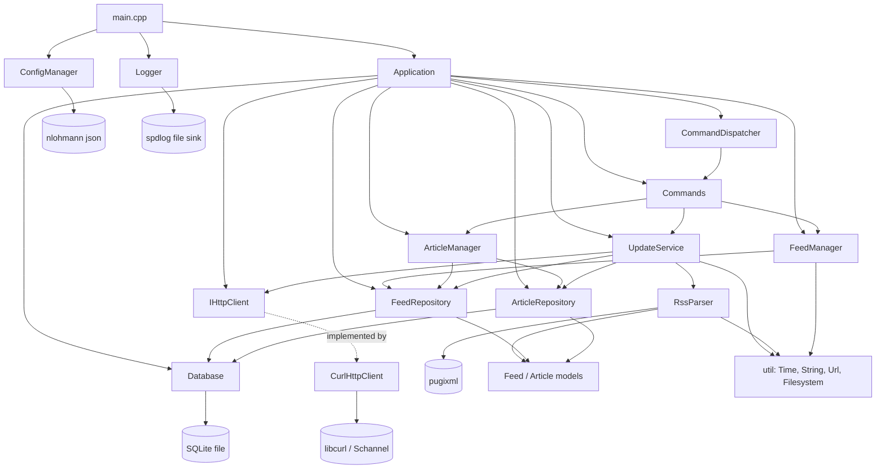

# RSS Reader — Implementation Plan (README Phase 1 / MVP)

Target: CMake 3.28+, MinGW-w64 (GCC), CLion 2026.3, Windows only, C++23 (C++20 minimum).

> **Scope rule.** This plan covers **only README Phase 1**. Anything belonging to Phases 2–4 (search, read/unread, favorites, categories UI, Atom, export, parallel updates, FTS, stats, TUI, `open`) is out of scope. Where the schema reserves a column for later use, it is stated explicitly. Section 15 lists every deferred item.

---

## 1. Project Summary

### Purpose
A terminal RSS reader. Phase 1 lets a user subscribe to RSS 2.0 feeds, download articles into a local SQLite database, and list and inspect them from the command line.

### Functional requirements (Phase 1)
| # | Feature | CLI |
|---|---------|-----|
| F1 | Add a feed | `rss add <url> [--name <name>]` |
| F2 | Remove a feed (and its articles) | `rss remove <feed-id>` |
| F3 | List feeds | `rss feeds` |
| F4 | Update all feeds (sequential) | `rss update` |
| F5 | Parse RSS 2.0 | internal |
| F6 | Store articles (dedup by link) | internal |
| F7 | List articles | `rss list [--feed <id>] [--limit <n>]` |
| F8 | Show article metadata | `rss show <article-id>` |
| F9 | SQLite persistence | internal |
| F10 | Logging | file log via spdlog |
| F11 | Unit and integration tests | GoogleTest + CTest |
| F12 | Help | `rss help`, `rss <command> --help` |

### Non-functional requirements
- Builds cleanly from CLion (MinGW toolchain, CMake preset) and from a plain terminal.
- The shipped `rss.exe` is self-contained (static runtime), so it runs outside CLion.
- No exceptions in business logic; `std::expected<T, Error>` everywhere (README strategy).
- No network access in any CTest test (HTTP is faked).
- Sequential execution; no threads.

### Major design decisions
1. **Layered architecture with a single composition root** (`Application`). Constructor injection by reference; one polymorphic interface only at the I/O boundary (`IHttpClient`).
2. **One static library `rss_core` + thin executable `rss`**, so tests link the exact same code as the app.
3. **Hand-rolled CLI parsing** driven by a declarative command table.
4. **SQLite amalgamation + `PRAGMA user_version` migrations.** Schema v1 includes feed metadata columns (nullable) so the later phases need no early migration.
5. **Times are `std::chrono::sys_seconds` in memory and ISO-8601 UTC text in SQLite.** No `zoned_time` or tzdb (MinGW libstdc++ has no tz database); RFC 822 dates are parsed by hand.
6. **Empty feed name means "adopt the channel title on first successful update."** `rss add` does no network I/O.
7. **Windows-only code is isolated** in `util/Filesystem.cpp` and `main.cpp`.

---

## 2. High-Level Architecture

**Style:** layered, modular, single-threaded, composition-root dependency injection.

```text
┌──────────────────────────────────────────────────────────┐
│ Presentation   main.cpp · CommandDispatcher · Commands   │
├──────────────────────────────────────────────────────────┤
│ Application    Application (composition root, owns all)  │
├──────────────────────────────────────────────────────────┤
│ Core/Services  FeedManager · ArticleManager · UpdateSvc  │
├──────────────────────────────────────────────────────────┤
│ Infrastructure Database · FeedRepo · ArticleRepo         │
│                IHttpClient/CurlHttpClient · RssParser    │
│                ConfigManager · Logger                    │
├──────────────────────────────────────────────────────────┤
│ Foundation     Error/Result · models · util::*           │
└──────────────────────────────────────────────────────────┘
```

Dependencies point downward only. Models and `util` depend on nothing project-specific except `Error`.

### Subsystems
| Subsystem | Responsibility |
|---|---|
| CLI (`cli/`) | Tokenize args, validate against the command table, route to handlers, print results, return exit codes |
| App (`app/`) | Build and own the object graph; run one command |
| Core (`core/`) | Business rules: validate and add feeds, list and fetch articles |
| Services (`services/`) | `UpdateService`: orchestrates HTTP → parse → store for each feed |
| Database (`database/`) | SQLite RAII wrapper, schema migration, SQL for feeds and articles |
| Network (`network/`) | HTTP GET with conditional headers (libcurl behind an interface) |
| Parsers (`parsers/`) | RSS 2.0 XML → `ParsedFeed` |
| Config / Logging | Load and validate JSON config; initialize spdlog |

### Data flow: `rss update`
```text
argv → CommandDispatcher → Commands::update → UpdateService::update_all
  → FeedRepository::get_all
  → for each feed:
      IHttpClient::get(url, etag, last_modified)
        ├─ 304 → NotModified, record success
        ├─ 200 → RssParser::parse(body) → ParsedFeed
        │         ArticleRepository::upsert_many (dedup on link)
        │         FeedRepository::record_fetch_success (+ adopt title if name empty)
        └─ error → FeedRepository::record_fetch_failure (last_error, failure_count++)
  → UpdateSummary → printed → exit code (0 all ok, 1 any feed failed)
```

---

## 3. Class Design

Conventions used in all signatures: types `PascalCase`; functions, methods, and members `snake_case`; private members end with `_`; interfaces start with `I`. All functions that return `Result<T>` are `[[nodiscard]]`. Everything is in `namespace rss` (utilities in `rss::util`). `#pragma once` in all headers.

### Class: `Error` / `Result<T>` (`core/Error.hpp`)

#### Responsibility
The shared error type and alias used by every fallible function.

#### Public Interface
```cpp
enum class ErrorCode {
    InvalidArgument, NotFound, AlreadyExists,
    Network, Parse, Database, Config, Io, Unsupported, Internal
};

struct Error {
    ErrorCode   code {ErrorCode::Internal};
    std::string message;
};

template <class T> using Result = std::expected<T, Error>;

[[nodiscard]] inline std::unexpected<Error> make_error(ErrorCode c, std::string msg) {
    return std::unexpected<Error>{Error{c, std::move(msg)}};
}
[[nodiscard]] std::string_view to_string(ErrorCode) noexcept;
```

#### Member Variables
As shown (plain aggregate).

#### Dependencies
`<expected>`, `<string>`. None on other project code.

#### Notes
- Messages are human-readable and safe to print to the user as-is. Technical detail (SQLite error text, curl error text) goes in `message`, not in a separate field.
- Propagate with `if (!r) return std::unexpected(r.error());`.

---

### Class: models — `Feed`, `Article`, `ParsedFeed` (`model/*.hpp`)

#### Responsibility
Plain data carriers. No behavior beyond trivial helpers.

#### Public Interface
```cpp
// model/Feed.hpp
struct Feed {
    int          id {};
    std::string  name;                          // "" = not yet known
    std::string  url;                           // normalized, unique
    std::string  category;                      // stored, unused in Phase 1
    util::TimePoint                created_at {};
    std::optional<util::TimePoint> last_updated;
    std::optional<std::string>     etag;
    std::optional<std::string>     last_modified;   // raw HTTP header value
    std::optional<std::string>     last_error;
    int          failure_count {};

    [[nodiscard]] std::string display_name() const;  // name if non-empty, else url
};

// model/Article.hpp
struct Article {
    int          id {};
    int          feed_id {};
    std::string  guid;                  // may be empty
    std::string  title;
    std::string  link;                  // unique key
    std::string  summary;               // raw text/HTML from <description>
    std::string  author;
    util::TimePoint published {};       // pubDate, or fetch time if missing/invalid
    bool         read {};               // reserved (Phase 2)
    bool         starred {};            // reserved (Phase 2)
};

// model/Category.hpp — intentionally NOT created in Phase 1 (category is a string on Feed).

// parsers/RssParser.hpp
struct ParsedFeed {
    std::string          title;
    std::vector<Article> articles;   // id/feed_id unset (0)
};
```

#### Notes
- `std::string` is used instead of `optional<string>` for text fields; SQL NULL ↔ empty string for `category`, `guid`, `author`.
- `id == 0` means "not persisted".

---

### Class: `AppConfig` and `ConfigManager` (`config/ConfigManager.hpp`)

#### Responsibility
Define configuration and load/validate it from JSON. Missing file → built-in defaults.

#### Public Interface
```cpp
struct AppConfig {
    std::filesystem::path database {"rss.db"};  // resolved to absolute by load()
    int         update_threads {4};     // validated (1..64), IGNORED in Phase 1
    int         timeout_seconds {15};   // 1..300
    std::string log_level {"info"};     // trace|debug|info|warn|error|critical|off
    bool        open_browser {true};    // validated, IGNORED in Phase 1
    std::filesystem::path base_dir;     // directory used to resolve relative paths
};

class ConfigManager {
public:
    // path: config file to read. If it does not exist -> defaults (base_dir = fallback_base_dir).
    [[nodiscard]] static Result<AppConfig> load(const std::filesystem::path& file,
                                                const std::filesystem::path& fallback_base_dir);
    [[nodiscard]] static Result<AppConfig> parse(std::string_view json_text,
                                                 const std::filesystem::path& base_dir);
    [[nodiscard]] static std::filesystem::path default_config_path(); // <exe_dir>/config.json
};
```

#### Member Variables
None (static functions).

#### Dependencies
`nlohmann::json`, `util::Filesystem`.

#### Notes
- Parse with `json::parse(text, nullptr, /*allow_exceptions=*/false)` and check `is_discarded()`. Never call `.at()` or `.value()` on untrusted types. Check `is_number_integer()` / `is_string()` / `is_boolean()` first.
- Unknown keys are ignored. Wrong type or out-of-range value → `ErrorCode::Config` naming the key.
- A relative `database` is resolved against `base_dir` (the config file's directory, or the exe directory when using defaults).
- `config/default_config.json` is a reference sample copied from the README; it is not loaded automatically.

---

### Class: `Logger` (`logging/Logger.hpp`)

#### Responsibility
Initialize spdlog once with a rotating file sink.

#### Public Interface
```cpp
class Logger {
public:
    [[nodiscard]] static Result<void> init(std::string_view level,
                                           const std::filesystem::path& log_file);
    static void shutdown() noexcept;
};
```

#### Notes
- Sink: `spdlog::sinks::rotating_file_sink_mt`, 1 MiB × 3 files. Pattern: `[%Y-%m-%d %H:%M:%S.%e] [%l] %v`. Set as the default logger; use `spdlog::info(...)` etc. directly everywhere.
- **No console sink.** stdout/stderr belong to the CLI output. Errors reach the user through returned `Error`s and `Commands`.
- Log file: `<database directory>/rss.log`.
- If `init` fails (e.g. read-only dir), `main` prints a warning to stderr and continues; spdlog's default console logger is replaced by a null logger so nothing leaks onto stdout.
- `Logger::init` can be called multiple times in tests (it replaces the default logger). Tests call it with `"off"`.

---

### Class: `Database`, `Statement`, `Transaction` (`database/Database.hpp`)

#### Responsibility
RAII wrapper over one SQLite connection; prepared statements; transactions; schema migration.

#### Public Interface
```cpp
struct sqlite3; struct sqlite3_stmt;     // forward declarations; <sqlite3.h> only in .cpp

class Statement {
public:
    Statement(Statement&&) noexcept;
    Statement& operator=(Statement&&) noexcept;
    ~Statement();
    Statement(const Statement&) = delete;
    Statement& operator=(const Statement&) = delete;

    [[nodiscard]] Result<void> bind_int64(int index, std::int64_t v);          // 1-based
    [[nodiscard]] Result<void> bind_text(int index, std::string_view v);
    [[nodiscard]] Result<void> bind_null(int index);
    [[nodiscard]] Result<void> bind_optional_text(int index, const std::optional<std::string>& v);
    [[nodiscard]] Result<bool> step();           // true = row available, false = done
    [[nodiscard]] Result<void> reset();          // also clears bindings

    [[nodiscard]] std::int64_t               column_int64(int col) const;
    [[nodiscard]] std::string                column_text(int col) const;           // NULL -> ""
    [[nodiscard]] std::optional<std::string> column_optional_text(int col) const;  // NULL -> nullopt
    [[nodiscard]] bool                       column_is_null(int col) const;
private:
    friend class Database;
    Statement(sqlite3* db, sqlite3_stmt* stmt) noexcept;
    sqlite3* db_ {};          // non-owning, for error messages
    sqlite3_stmt* stmt_ {};   // owned, finalized in destructor
};

class Transaction {
public:
    Transaction(Transaction&&) noexcept;
    ~Transaction();                         // rolls back if not committed
    [[nodiscard]] Result<void> commit();
private:
    friend class Database;
    explicit Transaction(sqlite3* db) noexcept;
    sqlite3* db_ {};
    bool active_ {true};
};

class Database {
public:
    // location: file path or ":memory:". Creates the file if missing. Runs PRAGMAs, NOT migrations.
    [[nodiscard]] static Result<Database> open(std::string_view location);
    Database(Database&&) noexcept;
    Database& operator=(Database&&) noexcept;
    ~Database();

    [[nodiscard]] Result<void>        migrate();                 // idempotent
    [[nodiscard]] Result<void>        execute(std::string_view sql);
    [[nodiscard]] Result<Statement>   prepare(std::string_view sql);
    [[nodiscard]] Result<Transaction> begin_transaction();       // BEGIN IMMEDIATE
    [[nodiscard]] std::int64_t        last_insert_rowid() const noexcept;
    [[nodiscard]] int                 changes() const noexcept;
    [[nodiscard]] int                 schema_version();          // PRAGMA user_version
private:
    struct Closer { void operator()(sqlite3*) const noexcept; };
    std::unique_ptr<sqlite3, Closer> db_;
};
```

#### Member Variables
`db_` as above. `Statement`/`Transaction` hold raw `sqlite3*` that stays valid while the owning `Database` lives. A moved `Database` keeps the same connection pointer, so existing statements remain valid.

#### Dependencies
sqlite3 (amalgamation), `Error`.

#### Notes
- On open: `PRAGMA foreign_keys = ON; PRAGMA journal_mode = WAL;` (WAL is skipped silently for `:memory:`) `PRAGMA synchronous = NORMAL; PRAGMA busy_timeout = 5000;`.
- `migrate()`: read `user_version`. If `0` → run schema v1 (Section 8) in one transaction and set `user_version = 1`. If `1` → no-op. If greater than the known version → `ErrorCode::Database` ("database was created by a newer version"). Implement migrations as an ordered array `{version, sql}` so later phases just append.
- Translate every non-OK SQLite return code into `Error{Database, sqlite3_errmsg(db)}`. Use `sqlite3_prepare_v2`, `sqlite3_bind_text(..., SQLITE_TRANSIENT)`.
- Statement text is never built by concatenating user input. Always bind parameters.
- `column_text` must handle `sqlite3_column_text` returning `nullptr`.

---

### Class: `FeedRepository` (`database/FeedRepository.hpp`)

#### Responsibility
All SQL for the `feeds` table.

#### Public Interface
```cpp
class FeedRepository {
public:
    explicit FeedRepository(Database& db) noexcept;

    [[nodiscard]] Result<Feed>               add(const Feed& feed);          // returns feed with id; AlreadyExists on duplicate url
    [[nodiscard]] Result<void>               remove(int id);                  // NotFound if no row; cascades to articles
    [[nodiscard]] Result<std::vector<Feed>>  get_all();                       // ORDER BY id
    [[nodiscard]] Result<Feed>               get_by_id(int id);               // NotFound
    [[nodiscard]] Result<bool>               exists_by_url(std::string_view url);

    [[nodiscard]] Result<void> record_fetch_success(int id, util::TimePoint when,
                                                    const std::optional<std::string>& etag,
                                                    const std::optional<std::string>& last_modified);
    [[nodiscard]] Result<void> record_fetch_failure(int id, util::TimePoint when, std::string_view error);
    [[nodiscard]] Result<void> set_name(int id, std::string_view name);
private:
    Database& db_;
};
```

#### Notes
- `record_fetch_success`: sets `last_updated`, `etag`, `last_modified`, `last_error = NULL`, `failure_count = 0`. On a 304 the caller passes the existing validators.
- `record_fetch_failure`: sets `last_error`, `failure_count = failure_count + 1`; leaves `last_updated` unchanged.
- Detect duplicates via the UNIQUE constraint (`SQLITE_CONSTRAINT_UNIQUE`) or a pre-check with `exists_by_url`. Prefer the pre-check and still map a constraint failure to `AlreadyExists`.
- Ownership: borrows `Database&`; the `Database` must outlive the repository.

---

### Class: `ArticleRepository` (`database/ArticleRepository.hpp`)

#### Responsibility
All SQL for the `articles` table.

#### Public Interface
```cpp
struct UpsertStats { int inserted {}; int skipped {}; };

struct ArticleQuery {
    std::optional<int> feed_id;
    int limit {50};            // 1..1000
};

class ArticleRepository {
public:
    explicit ArticleRepository(Database& db) noexcept;

    // One transaction. INSERT ... ON CONFLICT(link) DO NOTHING. Existing rows are never modified.
    [[nodiscard]] Result<UpsertStats>          upsert_many(int feed_id, const std::vector<Article>& articles);
    [[nodiscard]] Result<std::vector<Article>> list(const ArticleQuery& query);   // published DESC, id DESC
    [[nodiscard]] Result<Article>              get_by_id(int id);                 // NotFound
private:
    Database& db_;
};
```

#### Notes
- `upsert_many` prepares the statement once, binds/steps/resets per article inside a single `Transaction`, and counts `inserted` using `changes()`.
- `list` must not load more than `limit` rows.
- The `articles.link` UNIQUE constraint is global, so the same URL appearing in two feeds is stored once (under the first feed). This is an accepted Phase 1 limitation.

---

### Class: `IHttpClient`, `CurlHttpClient` (`network/HttpClient.hpp`)

#### Responsibility
Perform HTTP GETs with conditional-request support. The interface exists so that `UpdateService` is testable without a network.

#### Public Interface
```cpp
struct HttpRequest {
    std::string                url;
    std::optional<std::string> if_none_match;      // etag
    std::optional<std::string> if_modified_since;  // Last-Modified value
};

struct HttpResponse {
    int                        status_code {};     // 200, 304, ...
    std::string                body;
    std::optional<std::string> etag;
    std::optional<std::string> last_modified;
};

class IHttpClient {
public:
    virtual ~IHttpClient() = default;
    // Transport errors -> Error{Network}. HTTP error statuses (4xx/5xx) are RETURNED as responses.
    [[nodiscard]] virtual Result<HttpResponse> get(const HttpRequest&) = 0;
};

struct HttpClientOptions {
    int         timeout_seconds {15};
    int         connect_timeout_seconds {10};
    long        max_redirects {5};
    std::size_t max_body_bytes {10 * 1024 * 1024};
    std::string user_agent {"rss-reader/0.1"};
};

class CurlHttpClient final : public IHttpClient {
public:
    explicit CurlHttpClient(HttpClientOptions options = {});
    ~CurlHttpClient() override;
    CurlHttpClient(const CurlHttpClient&) = delete;
    CurlHttpClient& operator=(const CurlHttpClient&) = delete;
    Result<HttpResponse> get(const HttpRequest&) override;
private:
    HttpClientOptions options_;
    std::unique_ptr<CURL, CurlEasyDeleter> easy_;   // reused handle; curl_easy_reset() each call
};
```

#### Notes
- `curl_global_init` must run once: use a function-local static RAII object inside the `CurlHttpClient` constructor (calls `curl_global_cleanup` at exit).
- Options per request: `CURLOPT_FOLLOWLOCATION=1`, `CURLOPT_MAXREDIRS`, `CURLOPT_TIMEOUT`, `CURLOPT_CONNECTTIMEOUT`, `CURLOPT_USERAGENT`, `CURLOPT_PROTOCOLS_STR="http,https"`, `CURLOPT_ERRORBUFFER`, `CURLOPT_NOSIGNAL=1`. Do **not** set `Accept-Encoding` (zlib is not linked; servers then send identity).
- Write callback appends to `body` and aborts (returns 0) when `max_body_bytes` is exceeded → `Error{Network, "response too large"}`.
- Header callback captures `ETag` and `Last-Modified` (case-insensitive, trimmed). When redirects occur, keep only the headers of the **last** response (reset captured values when a new `HTTP/` status line is seen).
- Send `Accept: application/rss+xml, application/xml, text/xml;q=0.9, */*;q=0.8`.
- `timeout_seconds` comes from `AppConfig`.
- TLS uses Windows Schannel (native certificate store); no CA bundle management.

---

### Class: `RssParser` (`parsers/RssParser.hpp`)

#### Responsibility
Convert an RSS 2.0 document into a `ParsedFeed`.

#### Public Interface
```cpp
class RssParser {
public:
    // fetch_time is used as the fallback for missing/unparseable pubDate.
    [[nodiscard]] static Result<ParsedFeed> parse(std::string_view xml, util::TimePoint fetch_time);
};
```

#### Notes
- Use `pugi::xml_document::load_buffer(data, size, pugi::parse_default, pugi::encoding_auto)`. Parse failure → `Error{Parse, "<pugi description> at offset N"}`.
- Root `<rss>` → proceed with `channel`. Root `<feed>` → `Error{Unsupported, "Atom feeds are not supported yet"}`. Root `<rdf:RDF>` or anything else → `Error{Parse, "not an RSS 2.0 document"}`.
- Field mapping for each `<item>`:
  - `title` ← `title` (trimmed)
  - `link` ← `link` (trimmed); if empty and `guid` has `isPermaLink != "false"` and looks like an http(s) URL → use the guid text; otherwise **skip the item** and `spdlog::warn`.
  - `guid` ← `guid`
  - `summary` ← `description` (raw, trimmed; CDATA is handled by pugixml)
  - `author` ← `author`, else `dc:creator` (match by local name `dc:creator`)
  - `published` ← `util::parse_rfc822(pubDate)`; on failure/missing → `fetch_time`
- Items with an invalid `link` (not http/https per `util::Url`) are skipped with a warning.
- `ParsedFeed::title` ← `channel/title`, trimmed.
- Empty channel (zero items) is **valid**, not an error.
- Known limitation: pugixml does not transcode non-UTF-8 documents lacking a BOM. Not addressed in Phase 1.

---

### Class: `FeedManager` (`core/FeedManager.hpp`)

#### Responsibility
Business rules for subscribing and unsubscribing.

#### Public Interface
```cpp
class FeedManager {
public:
    FeedManager(FeedRepository& feeds, util::NowFn now = util::system_now);

    [[nodiscard]] Result<Feed>              add_feed(std::string_view url, std::string_view name = {});
    [[nodiscard]] Result<void>              remove_feed(int id);
    [[nodiscard]] Result<std::vector<Feed>> list_feeds();
private:
    FeedRepository& feeds_;
    util::NowFn     now_;
};
```

#### Notes
- `add_feed`: `util::Url::normalize` (trim, validate http/https + host, lowercase scheme and host) → `InvalidArgument` on failure; `AlreadyExists` if present; otherwise insert with `created_at = now_()`, empty `name` if none given (trimmed).
- No network access here.
- `remove_feed(id)`: `id <= 0` → `InvalidArgument`; otherwise delegates (`NotFound` propagates).

---

### Class: `ArticleManager` (`core/ArticleManager.hpp`)

#### Responsibility
Read-side operations on articles with validation.

#### Public Interface
```cpp
class ArticleManager {
public:
    ArticleManager(ArticleRepository& articles, FeedRepository& feeds);
    [[nodiscard]] Result<std::vector<Article>> list_articles(const ArticleQuery& q);
    [[nodiscard]] Result<Article>              get_article(int id);
private:
    ArticleRepository& articles_;
    FeedRepository&    feeds_;
};
```

#### Notes
- `list_articles`: validate `limit` in `[1, 1000]` (`InvalidArgument`); if `feed_id` is set, verify the feed exists (`NotFound`).
- `get_article`: `id <= 0` → `InvalidArgument`.

---

### Class: `UpdateService` (`services/UpdateService.hpp`)

#### Responsibility
Fetch, parse, and store updates for feeds, sequentially.

#### Public Interface
```cpp
enum class FeedUpdateStatus { Updated, NotModified, Failed };

struct FeedUpdateResult {
    int              feed_id {};
    std::string      feed_name;       // display_name at time of update
    FeedUpdateStatus status {FeedUpdateStatus::Failed};
    int              new_articles {};
    std::string      error;           // empty unless Failed
};

struct UpdateSummary {
    std::vector<FeedUpdateResult> results;
    [[nodiscard]] int updated() const noexcept;
    [[nodiscard]] int not_modified() const noexcept;
    [[nodiscard]] int failed() const noexcept;
    [[nodiscard]] int total_new_articles() const noexcept;
};

class UpdateService {
public:
    UpdateService(FeedRepository& feeds, ArticleRepository& articles,
                  IHttpClient& http, util::NowFn now = util::system_now);

    [[nodiscard]] Result<UpdateSummary> update_all();          // Error only if feeds cannot be loaded
    [[nodiscard]] FeedUpdateResult      update_feed(const Feed& feed);  // never throws, never aborts the batch
private:
    FeedRepository&    feeds_;
    ArticleRepository& articles_;
    IHttpClient&       http_;
    util::NowFn        now_;
};
```

#### Notes
- `update_feed` algorithm:
  1. Build `HttpRequest` using the stored `etag`/`last_modified`.
  2. `http_.get`: transport error → `record_fetch_failure`, status `Failed`.
  3. `status_code == 304` → `record_fetch_success` (same validators), status `NotModified`.
  4. `status_code` outside 200–299 → failure `"HTTP <code>"`.
  5. `RssParser::parse(body, fetch_time)`: error → failure with the parser message.
  6. `upsert_many`: error → failure.
  7. If `feed.name` is empty and parsed title is non-empty → `set_name`.
  8. `record_fetch_success` with the response validators; status `Updated`, `new_articles = stats.inserted`.
- Repository errors while *recording* the outcome are logged (`spdlog::error`) and do not change the returned status.
- One feed's failure never aborts the loop. Log: `info` per feed on success, `warn` on failure.
- **Concurrency seam:** `update_all` is the only place that loops over feeds. A later phase can replace the loop without touching `update_feed`'s contract (it would then need a connection-per-thread repository design; see Section 10).

---

### Class: `CommandDispatcher`, `ParsedArgs`, `CommandSpec` (`cli/CommandDispatcher.hpp`)

#### Responsibility
Parse `argv` against a declarative command table, validate, and invoke handlers.

#### Public Interface
```cpp
struct ParsedArgs {
    std::string                                command;
    std::vector<std::string>                   positionals;
    std::unordered_map<std::string, std::string> flags;   // "--feed" -> "1"; boolean flags -> ""
    bool help_requested {false};

    [[nodiscard]] std::optional<std::string_view> flag(std::string_view name) const;
    [[nodiscard]] bool has_flag(std::string_view name) const;
};

struct CommandSpec {
    std::string                 name;
    std::string                 summary;           // one line for the command list
    std::string                 usage;             // e.g. "rss list [--feed <id>] [--limit <n>]"
    std::size_t                 min_positionals {};
    std::size_t                 max_positionals {};
    std::vector<std::string>    value_flags;       // flags requiring a value
    std::function<int(const ParsedArgs&)> handler; // returns exit code
};

class CommandDispatcher {
public:
    CommandDispatcher(std::ostream& out, std::ostream& err);
    void register_command(CommandSpec spec);
    // args excludes argv[0].
    [[nodiscard]] int dispatch(std::span<const std::string> args);
    [[nodiscard]] std::string general_help() const;
private:
    std::ostream& out_;
    std::ostream& err_;
    std::vector<CommandSpec> commands_;   // insertion order = help order
};
```

#### Notes
- Exit codes: `0` success; `1` runtime failure; `2` usage error (unknown command, bad/missing arguments, unknown flag).
- Supported flag syntax: `--flag value` and `--flag=value`. Single `-h` / `--help` anywhere → help for that command. A literal `--` ends flag parsing. Flags not listed in `value_flags` are rejected as unknown (Phase 1 has no boolean flags except `--help`).
- No args, `help`, or `--help` → general help, exit `0` (no args → exit `2` after printing help to `err`).
- `dispatch` does not know command semantics; it never touches managers.
- `parse_int` for numeric arguments is in `util::String`; handlers produce usage errors for non-numeric ids.

---

### Class: `Commands` (`cli/Commands.hpp`)

#### Responsibility
The six command handlers: output formatting and error → exit code mapping.

#### Public Interface
```cpp
class Commands {
public:
    Commands(FeedManager&, ArticleManager&, UpdateService&, std::ostream& out, std::ostream& err);

    [[nodiscard]] int add(const ParsedArgs&);
    [[nodiscard]] int remove(const ParsedArgs&);
    [[nodiscard]] int feeds(const ParsedArgs&);
    [[nodiscard]] int update(const ParsedArgs&);
    [[nodiscard]] int list(const ParsedArgs&);
    [[nodiscard]] int show(const ParsedArgs&);

    // Registers all six into the dispatcher (binds member functions with lambdas).
    void register_all(CommandDispatcher&);
private:
    FeedManager& feeds_mgr_; ArticleManager& articles_mgr_; UpdateService& updater_;
    std::ostream& out_; std::ostream& err_;
};
```

#### Output formats (exact; tests assert on these)
`rss add <url>`:
```text
Added feed 3: https://example.com/feed.xml
Run 'rss update' to download articles.
```
`rss remove 3`: `Removed feed 3.`

`rss feeds` (columns: right-aligned ID, left-aligned Name padded/truncated to 28, Last Updated `YYYY-MM-DD HH:MM` UTC or `never`, Status `ok` or `error (<failure_count>)`; then URL on the same line, last):
```text
 ID  Name                          Last updated      Status     URL
  1  Ars Technica                  2026-11-15 14:02  ok         https://feeds.arstechnica.com/arstechnica/index
```
No feeds → `No feeds yet. Add one with: rss add <url>`.

`rss update` (one line per feed, then a summary):
```text
[1] Ars Technica: 12 new
[2] Example Blog: not modified
[3] Broken Feed: FAILED (HTTP 404)
Updated 1, not modified 1, failed 1. 12 new articles.
```
No feeds → `No feeds to update.` (exit 0). Exit `1` if any feed failed.

`rss list` (ID right-aligned, date `YYYY-MM-DD`, Feed ID, title truncated to 70 code points with `...`):
```text
   ID  Date        Feed  Title
   15  2026-11-14     1  Why coroutines are hard
```
No articles → `No articles. Run 'rss update' first.`

`rss show 15`:
```text
Title:     Why coroutines are hard
Feed:      Ars Technica (1)
Author:    Jane Doe
Published: 2026-11-14 09:30 UTC
Link:      https://example.com/a/15

<summary with HTML stripped via util::strip_html>
```
Errors are printed to `err_` as `error: <message>` and map to exit code `1` (`2` for `InvalidArgument` caused by argument parsing).

#### Notes
- All stdout/stderr writes go through the injected streams using `fmt::print(out_, ...)`. This keeps handlers unit-testable with `std::ostringstream`.
- Use `std::from_chars`-based `util::parse_int` for ids and limits.

---

### Class: `Application` (`app/Application.hpp`)

#### Responsibility
Composition root: owns every long-lived object and runs one command.

#### Public Interface
```cpp
class Application {
public:
    Application(AppConfig config, Database db, std::unique_ptr<IHttpClient> http,
                std::ostream& out, std::ostream& err);
    Application(const Application&) = delete;
    Application& operator=(const Application&) = delete;

    // Opens DB at config.database, migrates, builds a CurlHttpClient from config.
    [[nodiscard]] static Result<std::unique_ptr<Application>>
        create(AppConfig config, std::ostream& out, std::ostream& err);

    [[nodiscard]] int run(std::span<const std::string> args);
private:
    // DECLARATION ORDER IS THE DESTRUCTION CONTRACT (destroyed in reverse):
    AppConfig                    config_;
    std::unique_ptr<IHttpClient> http_;
    Database                     db_;
    FeedRepository               feed_repo_;
    ArticleRepository            article_repo_;
    FeedManager                  feed_manager_;
    ArticleManager               article_manager_;
    UpdateService                update_service_;
    Commands                     commands_;
    CommandDispatcher            dispatcher_;
};
```

#### Notes
- The public constructor takes an already-open `Database` and an injected `IHttpClient` so integration and end-to-end tests can pass `Database::open(":memory:")` (after `migrate()`) and a `FakeHttpClient`.
- The constructor calls `commands_.register_all(dispatcher_)`.
- `create` is the production path: `Database::open(config.database.string())` → `migrate()` → `CurlHttpClient{timeout from config}` → `std::make_unique<Application>`.

---

### Utilities (`util/`) — namespace `rss::util`

#### `Time.hpp / Time.cpp`
```cpp
using TimePoint = std::chrono::sys_seconds;
using NowFn     = std::function<TimePoint()>;

[[nodiscard]] TimePoint system_now();
[[nodiscard]] std::string to_iso8601(TimePoint);                    // "2026-11-15T14:02:11Z"
[[nodiscard]] Result<TimePoint> from_iso8601(std::string_view);     // strict "YYYY-MM-DDTHH:MM:SSZ"
[[nodiscard]] Result<TimePoint> parse_rfc822(std::string_view);     // see notes
[[nodiscard]] std::string format_date(TimePoint);                   // "2026-11-15"
[[nodiscard]] std::string format_datetime(TimePoint);               // "2026-11-15 14:02"
```
- `parse_rfc822` accepts: optional `Mon,`/`Tue,`… prefix; day 1–2 digits; English month abbreviation (case-insensitive); 2- or 4-digit year (2-digit: `<50` → 20xx, else 19xx); `HH:MM` or `HH:MM:SS`; zone = `GMT|UT|UTC|Z`, `EST|EDT|CST|CDT|MST|MDT|PST|PDT`, or `±HHMM`. Also tolerate ISO-8601 (`2026-11-14T09:30:00Z` / with `±HH:MM`) because real feeds contain it.
- Implementation uses `std::chrono::year_month_day`, `sys_days`, and arithmetic only. Do **not** use `std::chrono::parse`, `zoned_time`, `current_zone`, or `std::get_time` (portability on MinGW).
- Formatting uses `fmt::format("{:04}-{:02}-{:02}T{:02}:{:02}:{:02}Z", ...)` from `year_month_day` and `hh_mm_ss`. No locale dependence.

#### `String.hpp / String.cpp`
```cpp
[[nodiscard]] std::string_view trim(std::string_view);
[[nodiscard]] std::string      to_lower(std::string_view);                // ASCII only
[[nodiscard]] std::optional<std::int64_t> parse_int(std::string_view);    // whole string, no spaces, no sign other than '-'
[[nodiscard]] std::string      strip_html(std::string_view);              // remove tags, decode &amp; &lt; &gt; &quot; &#39; &nbsp; &#NNN; &#xHH;, collapse whitespace
[[nodiscard]] std::string      truncate(std::string_view, std::size_t max_code_points); // UTF-8 safe, appends "..."
[[nodiscard]] std::string      pad_right(std::string_view, std::size_t width);          // UTF-8 code-point aware
```

#### `Url.hpp / Url.cpp`
```cpp
struct ParsedUrl { std::string scheme, host, rest; };   // rest includes port/path/query
[[nodiscard]] Result<ParsedUrl> parse_url(std::string_view);       // http/https only; non-empty host; no whitespace
[[nodiscard]] Result<std::string> normalize_url(std::string_view); // trim; lowercase scheme+host; keep rest verbatim
[[nodiscard]] bool is_http_url(std::string_view);
```
Hand-written; no regex. Do not strip fragments or trailing slashes.

#### `Filesystem.hpp / Filesystem.cpp` (Windows-specific)
```cpp
[[nodiscard]] std::filesystem::path executable_directory();                          // GetModuleFileNameW
[[nodiscard]] Result<void>          ensure_parent_directory(const std::filesystem::path&);
[[nodiscard]] Result<std::string>   read_text_file(const std::filesystem::path&);    // binary read, strips UTF-8 BOM
```
Only file that includes `<windows.h>` (with `NOMINMAX`, `WIN32_LEAN_AND_MEAN` set as target compile definitions). `main.cpp` also includes it for `SetConsoleOutputCP`.

---

## 4. Class Interaction Model

### Ownership and lifetime
```text
main()
 └─ unique_ptr<Application>                     (owns everything below)
     ├─ AppConfig            (value)
     ├─ unique_ptr<IHttpClient>
     ├─ Database             (value; sole owner of the sqlite3*)
     ├─ FeedRepository       ── Database&
     ├─ ArticleRepository    ── Database&
     ├─ FeedManager          ── FeedRepository&
     ├─ ArticleManager       ── ArticleRepository&, FeedRepository&
     ├─ UpdateService        ── FeedRepository&, ArticleRepository&, IHttpClient&
     ├─ Commands             ── FeedManager&, ArticleManager&, UpdateService&, ostream&
     └─ CommandDispatcher    ── (holds std::function bound to Commands)
```
- **Composition / ownership:** `Application` owns all objects by value (or `unique_ptr` for the polymorphic client).
- **Dependency injection:** constructor injection of references to objects with strictly longer lifetime. No globals except spdlog's default logger and the curl global-init guard.
- **Non-owning references only:** managers and services never store `shared_ptr`.
- **Communication:** synchronous direct calls; results flow back as `Result<T>`; no callbacks or events.
- **Lifecycle:** objects are built once at startup, used for exactly one command, and destroyed in reverse member order.

### Example: handling `rss add https://x.org/feed`
`main` → `Application::run({"add","https://x.org/feed"})` → `CommandDispatcher::dispatch` parses and validates → `Commands::add` → `FeedManager::add_feed` (`normalize_url`, `exists_by_url`, `FeedRepository::add`) → prints the confirmation → returns `0`.

---

## 5. Source File Organization

Only Phase 1 files are listed. Files from the README layout that are **deliberately absent** are in Section 15.

```text
rss-reader/
├── CMakeLists.txt                 top-level: options, toolchain check, add_subdirectory
├── CMakePresets.json              debug / release presets (Ninja, binaryDir cmake-build-<type>)
├── README.md                      (update test framework to GoogleTest; add Phase-1 usage)
├── .gitignore                     cmake-build-*/, *.db, *.db-wal, *.db-shm, *.log, _deps
├── cmake/
│   ├── CheckToolchain.cmake       verifies <expected> and chrono calendar support compile
│   ├── CompilerWarnings.cmake     function rss_set_warnings(target)
│   └── Dependencies.cmake         all FetchContent declarations
├── config/
│   └── default_config.json        sample config (reference only)
├── data/.gitkeep
├── resources/
│   └── sample_feed.xml            RSS 2.0 sample used by parser tests
├── src/
│   ├── CMakeLists.txt             defines rss_core and rss
│   ├── main.cpp
│   ├── app/            Application.hpp / .cpp
│   ├── cli/            CommandDispatcher.hpp/.cpp · Commands.hpp/.cpp
│   ├── config/         ConfigManager.hpp/.cpp
│   ├── core/           Error.hpp · FeedManager.hpp/.cpp · ArticleManager.hpp/.cpp
│   ├── database/       Database.hpp/.cpp · FeedRepository.hpp/.cpp · ArticleRepository.hpp/.cpp
│   ├── logging/        Logger.hpp/.cpp
│   ├── model/          Feed.hpp · Article.hpp
│   ├── network/        HttpClient.hpp/.cpp
│   ├── parsers/        RssParser.hpp/.cpp
│   ├── services/       UpdateService.hpp/.cpp
│   └── util/           Time.hpp/.cpp · String.hpp/.cpp · Url.hpp/.cpp · Filesystem.hpp/.cpp
└── tests/
    ├── CMakeLists.txt
    ├── support/        FakeHttpClient.hpp · TestDb.hpp (in-memory DB helper) · TestData.hpp
    ├── unit/           TimeTests · StringTests · UrlTests · ConfigTests · RssParserTests
    │                   FeedManagerTests · CommandDispatcherTests
    └── integration/    DatabaseTests · RepositoryTests · UpdateServiceTests · ApplicationTests
```

Notes: `.hpp` + `.cpp` pairs are listed together. `Error.hpp` lives in `core/` and is header-only. The README listed util files as header-only; they get `.cpp` files here because they are non-trivial.

### File purposes and dependencies
| File | Purpose / main contents | Depends on |
|---|---|---|
| `core/Error.hpp` | `Error`, `ErrorCode`, `Result`, `make_error` | std |
| `util/Time.*` | time conversions, RFC 822 parser | `Error`, fmt |
| `util/String.*` | trim, parse_int, strip_html, truncate | std |
| `util/Url.*` | URL validation/normalization | `Error` |
| `util/Filesystem.*` | exe dir, mkdir, read file | `Error`, windows.h |
| `model/Feed.hpp`, `Article.hpp` | data structs | `util/Time.hpp` |
| `config/ConfigManager.*` | `AppConfig`, loading/validation | json, `Filesystem`, `Error` |
| `logging/Logger.*` | spdlog init | spdlog, `Error` |
| `database/Database.*` | SQLite RAII, migration | sqlite3, `Error` |
| `database/*Repository.*` | SQL per table | `Database`, models, `Time` |
| `network/HttpClient.*` | `IHttpClient`, `CurlHttpClient` | curl, `Error` |
| `parsers/RssParser.*` | RSS → `ParsedFeed` | pugixml, models, `Time`, `Url`, `String` |
| `core/FeedManager.*` | feed rules | `FeedRepository`, `Url` |
| `core/ArticleManager.*` | article reads | both repositories |
| `services/UpdateService.*` | update orchestration | repositories, `IHttpClient`, `RssParser` |
| `cli/CommandDispatcher.*` | arg parsing, routing | std, fmt |
| `cli/Commands.*` | handlers + formatting | managers, services, `CommandDispatcher`, fmt |
| `app/Application.*` | composition root | everything above |
| `main.cpp` | process entry | `Application`, `ConfigManager`, `Logger`, `Filesystem` |

**Include rule:** includes are rooted at `src/` (`#include "database/Database.hpp"`). A lower layer never includes a higher layer's header.

---

## 6. `main.cpp` Execution Flow

1. `SetConsoleOutputCP(CP_UTF8)`; set `std::ios::sync_with_stdio(false)` is **not** done (keep `fmt::print` + `std::cout` coherent).
2. Convert `argv[1..]` to `std::vector<std::string>` (`args`).
3. Extract the global option `--config <path>` (or `--config=<path>`) from `args` (anywhere before or after the command). Missing value → print usage error, exit `2`.
4. Resolve the config path: `--config` value or `ConfigManager::default_config_path()` (`<exe_dir>/config.json`).
5. `ConfigManager::load(path, executable_directory())`. On error: `error: <msg>` to stderr, exit `1`. (Logging is not up yet, so nothing is logged.)
6. `Filesystem::ensure_parent_directory(config.database)`; on error as above.
7. `Logger::init(config.log_level, config.database.parent_path() / "rss.log")`. On failure print a warning to stderr and continue.
8. `spdlog::info("rss starting, command={}", ...)`.
9. `Application::create(config, std::cout, std::cerr)`. On error: `error: <msg>`, exit `1`.
10. `exit_code = app->run(args)`.
11. Destroy `app` (reverse-order teardown closes the DB), `Logger::shutdown()`.
12. `return exit_code;`

Wrap steps 2–10 in `try { } catch (const std::exception& e) { fmt::print(stderr, "internal error: {}\n", e.what()); return 1; }` — this is the **only** place exceptions are caught (they stem from `bad_alloc` and similar).

---

## 7. Architecture Diagram



---

## 8. Data Models

### In-memory structures
`Feed`, `Article`, `ParsedFeed`, `AppConfig`, `HttpRequest/Response`, `UpdateSummary`, `ArticleQuery` are defined in Section 3. All are copyable value types, owned by whoever holds them, and have no synchronization (single-threaded).

### SQLite schema v1 (`PRAGMA user_version = 1`)
```sql
CREATE TABLE feeds (
    id             INTEGER PRIMARY KEY,
    name           TEXT    NOT NULL DEFAULT '',
    url            TEXT    NOT NULL UNIQUE,
    category       TEXT,                        -- reserved (Phase 2), always NULL in Phase 1
    created_at     TEXT    NOT NULL,            -- ISO-8601 UTC
    last_updated   TEXT,                        -- ISO-8601 UTC, NULL until first success
    etag           TEXT,
    last_modified  TEXT,                        -- raw HTTP header value
    last_error     TEXT,
    failure_count  INTEGER NOT NULL DEFAULT 0
);

CREATE TABLE articles (
    id         INTEGER PRIMARY KEY,
    feed_id    INTEGER NOT NULL,
    guid       TEXT,                            -- stored now; used for dedup in a later phase
    title      TEXT    NOT NULL DEFAULT '',
    link       TEXT    NOT NULL UNIQUE,
    summary    TEXT    NOT NULL DEFAULT '',
    author     TEXT    NOT NULL DEFAULT '',
    published  TEXT    NOT NULL,                -- ISO-8601 UTC
    read       INTEGER NOT NULL DEFAULT 0,      -- reserved (Phase 2)
    starred    INTEGER NOT NULL DEFAULT 0,      -- reserved (Phase 2)
    FOREIGN KEY (feed_id) REFERENCES feeds(id) ON DELETE CASCADE
);

CREATE INDEX idx_articles_feed_published ON articles(feed_id, published DESC);
CREATE INDEX idx_articles_published      ON articles(published DESC);
```
Differences from the README schema (deliberate): `NOT NULL` constraints, `ON DELETE CASCADE`, feed metadata columns, `guid`, and two indexes. `tags` / `article_tags` tables are **not** created in Phase 1; a later migration adds them.

### Serialization
- Time: ISO-8601 UTC text, e.g. `2026-11-15T14:02:11Z`. Lexical order equals chronological order, which `ORDER BY published` relies on.
- Config: JSON (Section 3, `AppConfig`). Default sample:
```json
{ "database": "rss.db", "update_threads": 4, "timeout_seconds": 15, "log_level": "info", "open_browser": true }
```

### Thread safety
None required. SQLite is compiled with its default serialized threading mode (`SQLITE_THREADSAFE=1`) so no change is needed later.

---

## 9. Error Handling Strategy

- **Return values, not exceptions.** Every fallible function returns `Result<T>`. Constructors that can fail are replaced by static factory functions (`Database::open`, `Application::create`).
- **No exceptions escape** third-party calls: nlohmann parse with `allow_exceptions=false`; pugixml returns `xml_parse_result`; SQLite and curl use return codes. The `try/catch` in `main` is a last resort only.
- **Propagation:** low layers create `Error` with a precise message; middle layers propagate unchanged. Add context only where it helps (`"feed 3: " + msg` in `UpdateService`).
- **Logging policy:** log where an error is *handled*, never on each propagation hop. `UpdateService` logs per-feed warnings; `main` does not log user-facing errors (they are printed). Repositories log nothing except `spdlog::debug` of SQL failures.
- **Recovery:** a failing feed never aborts `update`; failures are persisted (`last_error`, `failure_count`). A schema from a newer version aborts startup with a clear message. A corrupt database fails at `open`/`migrate` with `ErrorCode::Database`.
- **User-facing output:** `error: <message>` to stderr. Exit codes in Section 3 (`CommandDispatcher`).
- **Preconditions** (programmer errors, e.g. null statement) use `assert` in debug builds only.

---

## 10. Concurrency Plan

> No concurrency requirements identified.

Phase 1 is strictly single-threaded: one thread, one SQLite connection, sequential feed updates. `update_threads` is parsed and validated but ignored.

**Seam for later (informational, not implemented):** `UpdateService::update_all` is the only loop to parallelize; `IHttpClient::get` would need one client instance per worker (curl easy handles are not shareable), and database writes would be funneled through a single writer or a connection per thread. WAL mode is already enabled.

---

## 11. Build System Design (CMake + MinGW + CLion)

### Toolchain requirements
- CMake ≥ 3.28, Ninja (bundled with CLion), MinGW-w64 GCC **≥ 13** (for `<expected>` and `std::chrono` calendar types). Check in **CLion → Settings → Build, Execution, Deployment → Toolchains**; if the bundled MinGW is older, point to a newer MinGW-w64 (e.g., from MSYS2 `mingw-w64-ucrt-x86_64-gcc`).
- `cmake/CheckToolchain.cmake` uses `check_cxx_source_compiles` on a snippet using `std::expected` and `std::chrono::year_month_day` and **fails configuration with a clear message** if they do not compile. Do not add fallbacks.

### Top-level `CMakeLists.txt`
```cmake
cmake_minimum_required(VERSION 3.28)
project(rss_reader VERSION 0.1.0 LANGUAGES C CXX)   # C is needed for the sqlite3 amalgamation

set(CMAKE_CXX_STANDARD 23)
set(CMAKE_CXX_STANDARD_REQUIRED ON)
set(CMAKE_CXX_EXTENSIONS OFF)
set(CMAKE_EXPORT_COMPILE_COMMANDS ON)

option(RSS_BUILD_TESTS         "Build unit/integration tests" ON)
option(RSS_STATIC_RUNTIME      "Link libgcc/libstdc++/winpthread statically" ON)
option(RSS_WARNINGS_AS_ERRORS  "Treat warnings as errors" OFF)
option(RSS_USE_SYSTEM_CURL     "Use find_package(CURL) instead of FetchContent (fallback)" OFF)

list(APPEND CMAKE_MODULE_PATH "${CMAKE_SOURCE_DIR}/cmake")
include(CheckToolchain)
include(CompilerWarnings)
include(Dependencies)

add_subdirectory(src)
if(RSS_BUILD_TESTS)
    enable_testing()
    add_subdirectory(tests)
endif()
```

### `src/CMakeLists.txt`
- `add_library(rss_core STATIC ...)` with **explicit** source lists (no `GLOB`), listing every `.cpp` except `main.cpp`.
- `target_include_directories(rss_core PUBLIC ${CMAKE_CURRENT_SOURCE_DIR})`.
- `target_link_libraries(rss_core PUBLIC fmt::fmt spdlog::spdlog sqlite3 nlohmann_json::nlohmann_json pugixml::pugixml CURL::libcurl)`.
- `target_compile_definitions(rss_core PUBLIC NOMINMAX WIN32_LEAN_AND_MEAN UNICODE _UNICODE)`.
- `rss_set_warnings(rss_core)`.
- `add_executable(rss main.cpp)`, `target_link_libraries(rss PRIVATE rss_core)`, `rss_set_warnings(rss)`.
- If `RSS_STATIC_RUNTIME` and `MINGW`: `target_link_options(rss PRIVATE -static -static-libgcc -static-libstdc++)`.

### `cmake/Dependencies.cmake` (pins; verify each tag/URL exists and prefer the newest stable release at implementation time)
```cmake
include(FetchContent)
set(FETCHCONTENT_QUIET OFF)

# --- fmt ---
FetchContent_Declare(fmt GIT_REPOSITORY https://github.com/fmtlib/fmt.git GIT_TAG 11.0.2 SYSTEM)

# --- spdlog (external fmt) ---
set(SPDLOG_FMT_EXTERNAL ON CACHE BOOL "" FORCE)
set(SPDLOG_BUILD_EXAMPLE OFF CACHE BOOL "" FORCE)
set(SPDLOG_BUILD_TESTS   OFF CACHE BOOL "" FORCE)
FetchContent_Declare(spdlog GIT_REPOSITORY https://github.com/gabime/spdlog.git GIT_TAG v1.14.1 SYSTEM)

# --- nlohmann_json ---
set(JSON_BuildTests OFF CACHE BOOL "" FORCE)
FetchContent_Declare(json GIT_REPOSITORY https://github.com/nlohmann/json.git GIT_TAG v3.11.3 SYSTEM)

# --- pugixml ---
FetchContent_Declare(pugixml GIT_REPOSITORY https://github.com/zeux/pugixml.git GIT_TAG v1.14 SYSTEM)

# --- sqlite3 amalgamation (no CMakeLists in the archive; we build the target ourselves) ---
FetchContent_Declare(sqlite3_src
    URL https://www.sqlite.org/2024/sqlite-amalgamation-3460100.zip)   # add URL_HASH SHA3_256=... after first download

# --- libcurl (static, Schannel TLS, HTTP(S) only) ---
if(NOT RSS_USE_SYSTEM_CURL)
    set(BUILD_CURL_EXE OFF CACHE BOOL "" FORCE)
    set(BUILD_SHARED_LIBS OFF CACHE BOOL "" FORCE)
    set(BUILD_STATIC_LIBS ON CACHE BOOL "" FORCE)
    set(BUILD_TESTING OFF CACHE BOOL "" FORCE)
    set(HTTP_ONLY ON CACHE BOOL "" FORCE)
    set(CURL_USE_SCHANNEL ON CACHE BOOL "" FORCE)
    set(CURL_USE_OPENSSL OFF CACHE BOOL "" FORCE)
    set(CURL_USE_LIBPSL OFF CACHE BOOL "" FORCE)
    set(CURL_USE_LIBSSH2 OFF CACHE BOOL "" FORCE)
    set(USE_LIBIDN2 OFF CACHE BOOL "" FORCE)
    set(CURL_ZLIB OFF CACHE BOOL "" FORCE)
    set(CURL_BROTLI OFF CACHE BOOL "" FORCE)
    set(CURL_ZSTD OFF CACHE BOOL "" FORCE)
    set(CURL_DISABLE_LDAP ON CACHE BOOL "" FORCE)
    FetchContent_Declare(curl URL https://github.com/curl/curl/releases/download/curl-8_10_1/curl-8.10.1.tar.xz)
    FetchContent_MakeAvailable(curl)          # provides CURL::libcurl
else()
    find_package(CURL REQUIRED)               # MSYS2: pacman -S mingw-w64-x86_64-curl
endif()

FetchContent_MakeAvailable(fmt spdlog json pugixml sqlite3_src)
add_library(sqlite3 STATIC ${sqlite3_src_SOURCE_DIR}/sqlite3.c)
target_include_directories(sqlite3 SYSTEM PUBLIC ${sqlite3_src_SOURCE_DIR})
target_compile_definitions(sqlite3 PRIVATE SQLITE_DQS=0 SQLITE_OMIT_LOAD_EXTENSION)
target_compile_options(sqlite3 PRIVATE -w)

if(RSS_BUILD_TESTS)
    set(INSTALL_GTEST OFF CACHE BOOL "" FORCE)
    FetchContent_Declare(googletest GIT_REPOSITORY https://github.com/google/googletest.git GIT_TAG v1.15.2 SYSTEM)
    FetchContent_MakeAvailable(googletest)
endif()
```
Notes: the `BUILD_TESTING OFF` cache entry is for curl only; the project's own tests are gated by `RSS_BUILD_TESTS` plus a plain `enable_testing()`. The first configure downloads all dependencies and is slow; CLion caches them under `cmake-build-debug/_deps`. Set `FETCHCONTENT_BASE_DIR` to a shared folder (e.g. `D:/cmake-deps`) if multiple build dirs are used.

### `cmake/CompilerWarnings.cmake`
```cmake
function(rss_set_warnings target)
    target_compile_options(${target} PRIVATE
        -Wall -Wextra -Wpedantic -Wshadow -Wconversion -Wsign-conversion
        -Wold-style-cast -Wnon-virtual-dtor -Woverloaded-virtual -Wnull-dereference)
    if(RSS_WARNINGS_AS_ERRORS)
        target_compile_options(${target} PRIVATE -Werror)
    endif()
endfunction()
```
Applied to project targets only. Third-party targets use `SYSTEM`.

### `CMakePresets.json`
```json
{
  "version": 6,
  "cmakeMinimumRequired": { "major": 3, "minor": 28, "patch": 0 },
  "configurePresets": [
    { "name": "base", "hidden": true, "generator": "Ninja",
      "cacheVariables": { "CMAKE_EXPORT_COMPILE_COMMANDS": "ON" } },
    { "name": "debug", "inherits": "base", "displayName": "Debug",
      "binaryDir": "${sourceDir}/cmake-build-debug",
      "cacheVariables": { "CMAKE_BUILD_TYPE": "Debug" } },
    { "name": "release", "inherits": "base", "displayName": "Release",
      "binaryDir": "${sourceDir}/cmake-build-release",
      "cacheVariables": { "CMAKE_BUILD_TYPE": "Release" } }
  ],
  "buildPresets": [
    { "name": "debug",   "configurePreset": "debug" },
    { "name": "release", "configurePreset": "release" }
  ],
  "testPresets": [
    { "name": "debug", "configurePreset": "debug",
      "output": { "outputOnFailure": true } }
  ]
}
```
No compiler paths in the presets; CLion injects its MinGW toolchain, and terminal users need MinGW on `PATH`. The README commands (`cmake --preset debug`, `cmake --build --preset debug`, `ctest --test-dir cmake-build-debug --output-on-failure`) work unchanged.

### CLion setup notes
1. Open the project folder; accept loading `CMakePresets.json`; enable the **debug** profile; choose the MinGW toolchain.
2. Run configuration for `rss`: set **Program arguments** (e.g. `feeds`) and **Working directory** to a scratch dir if you want an isolated `rss.db`.
3. Tests appear in CLion's test runner via `gtest_discover_tests`.

---

## 12. Testing Strategy

### Framework and wiring
GoogleTest (via FetchContent) + CTest. `tests/CMakeLists.txt`:
```cmake
include(GoogleTest)
add_executable(rss_tests
    unit/TimeTests.cpp unit/StringTests.cpp unit/UrlTests.cpp unit/ConfigTests.cpp
    unit/RssParserTests.cpp unit/FeedManagerTests.cpp unit/CommandDispatcherTests.cpp
    integration/DatabaseTests.cpp integration/RepositoryTests.cpp
    integration/UpdateServiceTests.cpp integration/ApplicationTests.cpp)
target_link_libraries(rss_tests PRIVATE rss_core GTest::gtest_main)
target_include_directories(rss_tests PRIVATE ${CMAKE_CURRENT_SOURCE_DIR}/support)
target_compile_definitions(rss_tests PRIVATE RSS_TEST_RESOURCES_DIR="${CMAKE_SOURCE_DIR}/resources")
rss_set_warnings(rss_tests)
gtest_discover_tests(rss_tests DISCOVERY_MODE PRE_TEST)
```
`DISCOVERY_MODE PRE_TEST` avoids running the exe at build time (avoids DLL/path surprises on Windows). The README's `tests/test_main.cpp` is not needed because `GTest::gtest_main` supplies `main`.

### Test support
- `FakeHttpClient : IHttpClient`: map of URL → queued `Result<HttpResponse>`; records every `HttpRequest` received (so tests can assert on conditional headers).
- `TestDb.hpp`: `make_test_db()` → `Database::open(":memory:")` + `migrate()`, asserting success.
- `NowFn` fixtures return a fixed `TimePoint`.
- `Logger::init("off", ...)` is not needed: tests never initialize it, and spdlog's default logger writes to the console only on warnings; tests may call `spdlog::set_level(spdlog::level::off)` in a global environment.

### Unit tests (no DB or network except in-memory DB for FeedManager)
| Suite | Key cases |
|---|---|
| `TimeTests` | RFC 822 with `GMT`, `+0000`, `-0500`, `EST`, no weekday, no seconds, 2-digit year; ISO-8601 variants; invalid → error; ISO round trip; `1970-01-01`; leap day |
| `StringTests` | trim; parse_int (valid, empty, overflow, `12abc`, `-5`); strip_html (tags, entities, numeric entities, nested, whitespace); truncate on multibyte UTF-8 |
| `UrlTests` | valid http/https; missing scheme; `ftp://`; empty host; spaces; uppercase scheme/host normalization; ports and query preserved |
| `ConfigTests` | defaults; full file; partial file; invalid JSON; wrong types; out-of-range; unknown level; relative path resolution; missing file → defaults |
| `RssParserTests` | `sample_feed.xml`; missing pubDate; missing link → guid fallback; item skipped; CDATA description; `dc:creator`; empty channel; malformed XML; Atom root → `Unsupported`; non-feed XML |
| `FeedManagerTests` | add valid; normalize; duplicate; invalid URL; remove existing; remove missing; blank name; `created_at` from injected clock |
| `CommandDispatcherTests` | `--flag value`, `--flag=value`, `--`; unknown command/flag; missing value; positional count bounds; `--help`; exit codes |

### Integration tests (real SQLite in memory, fake HTTP)
| Suite | Key cases |
|---|---|
| `DatabaseTests` | `migrate` idempotent; `user_version == 1`; newer-version DB rejected; transaction rollback on scope exit; NULL handling in `column_optional_text`; foreign keys enforced |
| `RepositoryTests` | feed CRUD; duplicate URL; cascade delete removes articles; `upsert_many` counts inserted/skipped; re-upsert changes nothing; list ordering, limit, feed filter; fetch success/failure bookkeeping |
| `UpdateServiceTests` | first update stores articles and sets title; second update inserts none; sends `If-None-Match`/`If-Modified-Since`; 304; 404; transport error; malformed XML; Atom → failed with message; one failure does not stop others; `failure_count` increments then resets |
| `ApplicationTests` | see end-to-end below |

### End-to-end (user-facing scenarios)
`ApplicationTests` build an `Application` with an in-memory DB, `FakeHttpClient`, and `std::ostringstream` outputs, then call `run({...})`:
1. `add <url>` → `update` → `feeds` → `list` → `show <id>` produces the exact formats in Section 3.
2. `list --feed 99` → exit `1`, error on stderr.
3. `remove <id>` then `list` → no articles.
4. `add` duplicate → exit `1`; `add notaurl` → exit `1`; `show abc` → exit `2`; unknown command → exit `2`.
5. `update` with one failing and one working feed → exit `1` with both lines in the output.

**Manual smoke test (not in CTest):** with the built `rss.exe`, add two or three real feeds (e.g. the README's Ars Technica URL), run `update`, `list`, `show`. Record the result in the Stage 9 checklist.

### Directory structure
Shown in Section 5. The README's `tests/unit/FeedManagerTests.cpp`, `ParserTests.cpp` (renamed `RssParserTests.cpp`), `ConfigTests.cpp`, `integration/DatabaseTests.cpp`, `UpdateTests.cpp` (renamed `UpdateServiceTests.cpp`) are all covered.

### CI guidance
Any CI is optional for Phase 1. If added: Windows runner with MSYS2 MinGW-w64 GCC ≥ 13, `cmake --preset debug -DRSS_WARNINGS_AS_ERRORS=ON`, `cmake --build --preset debug`, `ctest --preset debug`. Cache `cmake-build-debug/_deps`.

### Coverage
The README's 80% goal is a *target*, measured optionally with `gcovr` (needs `--coverage` flags in a dedicated preset). Not a Phase 1 gate; the unit and integration lists above are the gate.

---

## 13. Incremental Implementation Plan

> The README calls this scope "Phase 1." To avoid confusion, the steps inside it are called **Stages**. Each stage builds and passes `ctest` on its own, and each only adds code that the previous stages support.

### Stage 0 — Skeleton and dependency spike
**Deliverables:** top-level and `src` CMake, `cmake/*.cmake`, `CMakePresets.json`, `.gitignore`; `main.cpp` that prints versions/proof of life from every dependency (fmt print; spdlog to a temp file; open `:memory:` SQLite and select `sqlite_version()`; `curl_version()`; pugixml parse of a literal; nlohmann parse of a literal); one trivial GoogleTest test.
**Completion criteria:**
- `cmake --preset debug && cmake --build --preset debug && ctest --test-dir cmake-build-debug --output-on-failure` succeeds from a terminal and from CLion.
- `rss.exe` runs from a different directory without any missing-DLL error.
- Toolchain check passes; if curl-via-FetchContent fails, resolve it now (use `-DRSS_USE_SYSTEM_CURL=ON` as the fallback) before continuing.

### Stage 1 — Foundation: errors and utilities
**Deliverables:** `Error.hpp`; `util/Time`, `String`, `Url`, `Filesystem`; models `Feed`, `Article`; tests `TimeTests`, `StringTests`, `UrlTests`.
**Completion criteria:** all those tests pass; no warnings with the warning set.

### Stage 2 — Config and logging
**Deliverables:** `ConfigManager`, `AppConfig`, `Logger`, `config/default_config.json`; `ConfigTests`.
**Completion criteria:** config tests pass; a tiny manual run writes a rotating log file in a temp dir.

### Stage 3 — Database layer
**Deliverables:** `Database`, `Statement`, `Transaction`, schema v1 migration; `TestDb.hpp`; `DatabaseTests`.
**Completion criteria:** `DatabaseTests` pass, including idempotent migration, rollback, and foreign-key enforcement.

### Stage 4 — Repositories
**Deliverables:** `FeedRepository`, `ArticleRepository`; `RepositoryTests`.
**Completion criteria:** CRUD, cascade, upsert counts, ordering/limit, and fetch bookkeeping tests pass.

### Stage 5 — RSS parsing
**Deliverables:** `RssParser`, `ParsedFeed`, `resources/sample_feed.xml`; `RssParserTests`.
**Completion criteria:** all parser cases pass, including malformed XML and Atom rejection.

### Stage 6 — HTTP client
**Deliverables:** `IHttpClient`, `HttpRequest/Response`, `CurlHttpClient`; `FakeHttpClient`.
**Completion criteria:** compiles and links cleanly; a manual one-off (temporary code or a throwaway test not registered with CTest) fetches a real HTTPS feed and prints status, `ETag`, and body size.

### Stage 7 — Core services
**Deliverables:** `FeedManager`, `ArticleManager`, `UpdateService`, `UpdateSummary`; `FeedManagerTests`, `UpdateServiceTests`.
**Completion criteria:** all tests pass; conditional-GET headers verified via `FakeHttpClient`.

### Stage 8 — CLI and application
**Deliverables:** `CommandDispatcher`, `Commands`, `Application`, final `main.cpp`; `CommandDispatcherTests`, `ApplicationTests`.
**Completion criteria:** end-to-end scenarios pass; `rss help` lists all commands; exit codes are as specified.

### Stage 9 — Hardening and hand-off
**Deliverables:** update `README.md` (GoogleTest, build/run instructions, command list, config location, Phase 1 scope); manual smoke test on 2–3 real feeds; warnings clean at `-Werror`; release preset builds and runs.
**Completion criteria:** the Phase 1 Definition of Done below is satisfied.

### Phase 1 Definition of Done
1. `rss add/remove/feeds/update/list/show/help` behave as specified.
2. Articles persist across runs in `rss.db`; repeated `update` creates no duplicates.
3. Logs are written to `rss.log`; stdout stays clean.
4. `ctest` passes from CLion and the terminal; no network access in tests.
5. Debug and Release presets build without warnings.
6. `rss.exe` runs standalone on Windows.

---

## 14. AI Implementation Guidance

### Patterns
- **Composition root + constructor injection** (`Application`). No singletons, no service locators.
- **Repository pattern** for SQL; managers/services never contain SQL.
- **Result-returning functions** instead of exceptions; **RAII** for every external resource (sqlite3, sqlite3_stmt, CURL, transactions, curl global init).
- **Table-driven CLI** (`CommandSpec`).
- Interfaces (`IHttpClient`) only where a test double is needed. Do not add interfaces for repositories or managers.

### Naming and layout
- Files: `PascalCase.hpp/.cpp` matching the main class. Namespace `rss`; `rss::util` for utilities; no `using namespace` in headers, and none at global scope in `.cpp` files except inside tests.
- Types `PascalCase`; functions/variables `snake_case`; private members `name_`; constants `snake_case` `constexpr` (no macros); enum values `PascalCase`.
- `#pragma once`. Every header is self-contained and includes what it uses. Include order: own header, project headers, third-party, standard library.
- Forward-declare `sqlite3`/`sqlite3_stmt`; do not include `<sqlite3.h>`, `<curl/curl.h>`, `<pugixml.hpp>`, `<windows.h>` from any header — only from `.cpp` files — **except** `util/Filesystem.cpp`/`main.cpp` for Windows APIs, which also stay in `.cpp`.

### Ownership and memory
- Value semantics by default; `std::unique_ptr` only for polymorphic ownership (`IHttpClient`) and C handles with custom deleters. No `shared_ptr`. No raw `new`/`delete`. Non-owning observers are references (never raw pointers).
- Pass `std::string_view` / `std::span` for read-only inputs, `const T&` for structs, by value for sinks (`std::string name` that is moved).
- Do not store references to temporaries; do not return `string_view` into locals.

### Error handling conventions
- Mark fallible functions `[[nodiscard]]` and return `Result<T>`; use `Result<void>` for no-value success.
- Never discard a `Result`. Never call `.value()`. Check `if (!r)`, then return or handle.
- Do not throw in project code. Do not catch exceptions except in `main`.

### Const correctness
`const` for all non-mutating member functions; `const&` parameters; `constexpr` where trivially possible; mark single-argument constructors `explicit`; mark classes `final` when they are not meant for inheritance.

### Style constraints
- No `GLOB` in CMake. No raw `printf`/`std::cout` outside `Commands`, `main`, and `CommandDispatcher`. No `std::endl` (use `'\n'`).
- No premature abstraction: do not implement anything listed in Section 15.
- Avoid `std::chrono::zoned_time`, `std::chrono::parse`, `std::format` (use fmt), `std::print`, and regex.

### Code-review checkpoints (per stage)
1. Builds with zero warnings under the project warning set.
2. New code has tests; the stage's listed tests are green.
3. No `<windows.h>` / third-party includes in headers (except as allowed above).
4. Every `Result` is checked or propagated; no exceptions thrown.
5. No SQL built by string concatenation with user data.
6. Member declaration order in `Application` still matches dependency order.
7. No Phase 2+ features introduced.

---

## 15. Risks and Open Questions

### Deferred from the README (explicitly **not** in this plan)
| README item | Deferred to |
|---|---|
| `rss list --unread/--today`, `rss read/unread`, `rss star/starred` | Phase 2 (columns `read`, `starred` exist but are unused) |
| `rss search`, `SearchService` | removed from scope by request |
| `rss open`, `open_browser` behavior | not in Phase 1 list (config key is accepted but ignored) |
| `rss stats` | Phase 3 |
| Categories (`Category.hpp`, category management) | Phase 2 (stored as a string only) |
| Atom (`AtomParser`) | Phase 2 (Atom feeds are rejected with a clear error) |
| Export (JSON) | after Phase 1 |
| Parallel updates (`update_threads`), FTS, feed health checks, dedup beyond `link` | Phase 3 |
| TUI (FTXUI) | Phase 4 |
| `scripts/` (bootstrap/package), `third_party/`, `docs/`, `sample_atom.xml`, `tags`/`article_tags` tables | not needed in Phase 1 (FetchContent replaces `third_party/`) |
| `Catch2`, `tests/test_main.cpp` | replaced by GoogleTest + `gtest_main` |

### Technical risks
| Risk | Impact | Mitigation |
|---|---|---|
| **libcurl via FetchContent on MinGW** (Schannel, static) is the most fragile build step | Stage 0 may stall | Do the dependency spike first; fall back to `RSS_USE_SYSTEM_CURL` with MSYS2 curl; as a last resort, link OpenSSL via MSYS2 |
| MinGW GCC older than 13 | no `<expected>` | Configure-time check; update toolchain in CLion |
| Schannel certificate revocation check fails on some networks | HTTPS errors (`CRYPT_E_NO_REVOCATION_CHECK`) | Document; optionally set `CURLSSLOPT_NO_REVOKE` later behind a config key |
| Windows ANSI `argv` mangles non-ASCII arguments (e.g. `--name`) | garbled names | Known limitation; fix later by reading `GetCommandLineW` and converting to UTF-8 |
| UTF-8 console output requires a UTF-8 capable font/terminal | `?` characters in titles | `SetConsoleOutputCP(CP_UTF8)`; Windows Terminal recommended |
| Non-UTF-8 feeds without BOM | garbled text | Known limitation |
| Real-world feeds have malformed dates, missing links, HTML in summaries | skipped/odd rows | Lenient date parser, fallback to fetch time, `strip_html` at display time |
| Global unique `link` drops cross-feed duplicates | article appears under one feed only | Accepted for Phase 1 |
| Database and log live next to `rss.exe` by default (inside `cmake-build-*` during development) | data lost when build dir is cleaned | Use `--config` with a config pointing to a stable path; document |
| Unpinned SQLite download hash | supply-chain risk | Add `URL_HASH` after the first successful download |

### Performance and scalability
Phase 1 targets hundreds of articles per feed and tens of feeds; sequential updates are acceptable. `upsert_many` uses one transaction per feed. Indexes cover list queries. No known concerns at this scale.

### Open questions (do not block Phase 1)
1. Where should the database and log live long-term (e.g. `%APPDATA%\rss-reader`)? Plan assumes next to the config file/exe.
2. Should `rss add` fetch immediately to validate the URL? Plan assumes no network on add.

---

## 16. Assumptions

| # | Assumption | Why | Impact | Clarify? |
|---|---|---|---|---|
| A1 | Scope is README Phase 1 only; search and all later features excluded | Stated by requester | Smaller schema and command set | No |
| A2 | C++23 with GCC ≥ 13 (CLion 2026.3's MinGW or a newer one) | Requester: "C++20 or 23, whatever CLion supports" | Configure fails clearly if unsupported; no feature-driven redesign | Verify toolchain version |
| A3 | GoogleTest replaces Catch2 | Requester's choice | README test line must change | No |
| A4 | Ninja generator with CMake presets | Matches CLion/README commands | none | No |
| A5 | `rss add` does no network I/O; empty name adopts channel title on first update | Keeps add fast and testable; name is `NOT NULL` | Slightly more logic in `UpdateService` | Low |
| A6 | Published date falls back to fetch time when missing/invalid | Keeps `published NOT NULL` and sorting sane | Items without dates sort by first-seen | No |
| A7 | RSS 2.0 only; RSS 1.0/RDF and Atom rejected with an error | README puts Atom in Phase 2 | Some feeds fail to update | No |
| A8 | `guid` column stored but dedup is by `link` only | Dedup is Phase 3; avoids a later migration | Unused column in Phase 1 | Low |
| A9 | Feed metadata columns included in schema v1; conditional GET implemented | Requester approved nullable columns; low cost | Slightly larger `UpdateService` | No |
| A10 | `category`, `read`, `starred` columns exist but are unused | Avoids early migration | Dead columns | No |
| A11 | Config file is `<exe_dir>/config.json`, overridable by `--config`; missing file = defaults | Windows-only, portable layout | DB/log next to exe by default | Yes (Open question 1) |
| A12 | Log file = `<db dir>/rss.log`; no console sink | Keeps stdout clean | Errors visible only via command output | No |
| A13 | `update_threads` and `open_browser` are parsed but ignored | Config schema from README is kept | none | No |
| A14 | `rss list` default limit 50, max 1000; `--limit` added | Needed to avoid dumping the whole table | Small CLI addition beyond README examples | No |
| A15 | Exit codes: 0 / 1 / 2 | Common convention | Tests assert on them | No |
| A16 | Time handling avoids tzdb/`zoned_time`/`chrono::parse` | MinGW libstdc++ gaps | Custom RFC 822 parser to maintain | No |
| A17 | libcurl built without zlib/brotli/zstd; no `Accept-Encoding` sent | Avoids extra dependencies | Slightly larger downloads | No |
| A18 | Versions in Section 11 are known-good pins; newer stable releases may be used | Knowledge may be stale | Verify tags/URLs at Stage 0 | Verify at Stage 0 |
| A19 | Static runtime linking for `rss.exe` | Runs without MinGW DLLs on PATH | Slightly larger binary | No |
